# 🐍 Python OOP Notes

> A simple, step-by-step guide to Object Oriented Programming in Python: Class, Object, Constructor, Magic Methods, Reference Variable, Pass by Reference, Encapsulation, Getter/Setter, and Class Variables.

## 📑 Table of Contents
1. [Class vs Object](#1-class-vs-object)
2. [Constructor](#2-constructor-__init__)
3. [Magic Methods: Fraction](#3-magic-methods-fraction-class)
4. [Coordinate Geometry: Point and Line](#4-coordinate-geometry-point-and-line)
5. [Accessing Attributes](#5-accessing-attributes)
6. [Reference Variable (Memory Diagram)](#6-reference-variable-memory-diagram)
7. [Pass by Reference](#7-pass-by-reference)
8. [Encapsulation](#8-encapsulation)
9. [Getter and Setter](#9-getter-and-setter)
10. [Objects in Collections](#10-objects-in-collections)
11. [Class Variable (Static Variable)](#11-class-variable-static-variable)
12. [Common Mistakes](#12-common-mistakes)

---

## 1. Class vs Object

| Term | Meaning |
|------|---------|
| **Class** | A blueprint. It defines the rules and methods. In Python, `list`, `str`, `tuple`, `set` and `dict` are all classes. |
| **Object** | A real instance created from a class. `L = [1, 2, 3]` creates an object of the `list` class. |

```python
L = [1, 2, 3]
print(type(L))      # <class 'list'>

# L.upper()         # ❌ AttributeError: the list class has no upper() method
L.append(4)         # ✅ append() belongs to the list class
```

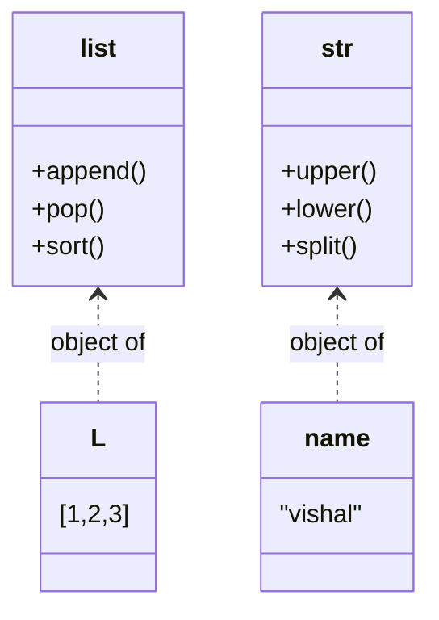

---

## 2. Constructor (`__init__`)

- It runs **automatically** when you create an object. You never call it yourself.
- Use it for setup work: default values, database connections, and so on.

### Example: ATM

```python
class Atm:
    def __init__(self):
        self.pin = ''
        self.balance = 0
        self.menu()                # menu starts as soon as the object is created

    def menu(self):
        user_input = int(input("""
        Hi, how can I help you?
        1. Create pin
        2. Change pin
        3. Check balance
        4. Withdraw
        5. Anything else to exit
        """))
        if user_input == 1:
            self.create_pin()
        elif user_input == 2:
            self.change_pin()
        elif user_input == 3:
            self.check_balance()
        elif user_input == 4:
            self.withdraw()
        else:
            pass                   # exit

    def create_pin(self):
        self.pin = int(input("Enter your pin: "))
        self.balance = int(input("Enter balance: "))
        print("Pin created successfully")
        self.menu()

    def change_pin(self):
        old_pin = int(input("Enter your old pin: "))
        if old_pin == self.pin:
            self.pin = int(input("Enter your new pin: "))
            print("Pin changed successfully")
        else:
            print("Invalid pin")
        self.menu()

    def check_balance(self):
        if int(input("Enter your pin: ")) == self.pin:
            print("Your current balance:", self.balance)
        else:
            print("Invalid pin")
        self.menu()

    def withdraw(self):
        if int(input("Enter your pin: ")) == self.pin:
            amount = int(input("Enter amount to withdraw: "))
            if amount <= self.balance:          # ✅ check balance first
                self.balance -= amount
                print("Withdraw successful. Balance:", self.balance)
            else:
                print("Insufficient balance")
        else:
            print("Invalid pin")
        self.menu()

obj = Atm()
```

### Flow Diagram

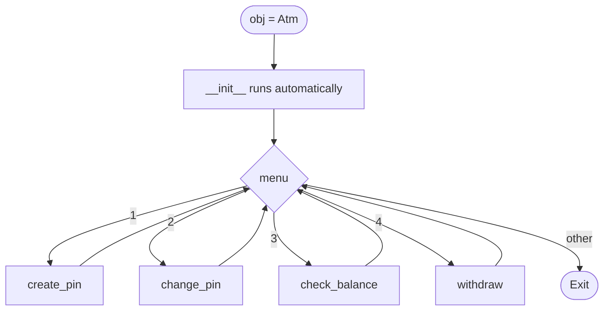

### Class Diagram

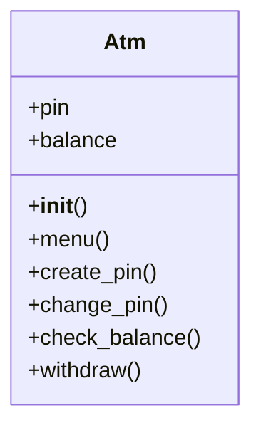

> ⚠️ **Note:** Calling `self.menu()` at the end of every method adds a new call to the stack each time. Real programs use a `while True:` loop instead.

---

## 3. Magic Methods: Fraction Class

Magic (dunder) methods let your own objects work with operators like `+`, `-`, `*` and with `print()`.

| You write | Python calls |
|---|---|
| `print(obj)` / `str(obj)` | `__str__` |
| `a + b` | `__add__` |
| `a - b` | `__sub__` |
| `a * b` | `__mul__` |
| `a / b` | `__truediv__` |

```python
class Fraction:
    def __init__(self, x, y):
        self.num = x
        self.deno = y

    def __str__(self):
        return "{}/{}".format(self.num, self.deno)

    def __add__(self, other):
        new_num = self.num * other.deno + other.num * self.deno
        new_deno = self.deno * other.deno
        return Fraction(new_num, new_deno)      # ✅ return a Fraction, not a string

    def __sub__(self, other):
        new_num = self.num * other.deno - other.num * self.deno
        new_deno = self.deno * other.deno
        return Fraction(new_num, new_deno)

    def __mul__(self, other):                   # ✅ plain "other", not "*other"
        return Fraction(self.num * other.num, self.deno * other.deno)

obj1 = Fraction(5, 3)
obj2 = Fraction(8, 3)

print(obj1 + obj2)            # 39/9
print(obj1 - obj2)            # -9/9
print(obj1 * obj2)            # 40/9
print((obj1 + obj2) * obj1)   # chaining works because __add__ returns a Fraction
```

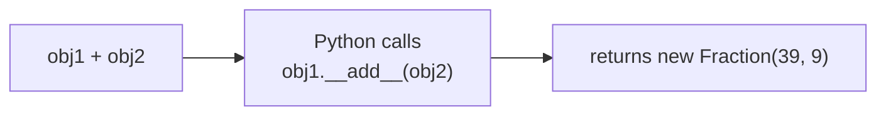

> The fractions are not simplified (`39/9` is not reduced to `13/3`). You can add that with `math.gcd` as an extra exercise.

---

## 4. Coordinate Geometry: Point and Line

**Requirements**
- Create and view 2D coordinates
- Find the distance between two points
- Find the distance of a point from the origin
- Check if a point lies on a line
- Find the distance between a point and a line

```python
class Point:
    def __init__(self, x, y):
        self.x_cod = x
        self.y_cod = y

    def __str__(self):
        return "<{},{}>".format(self.x_cod, self.y_cod)

    def euclidean_distance(self, other):
        return ((self.x_cod - other.x_cod) ** 2 + (self.y_cod - other.y_cod) ** 2) ** 0.5

    def distance_from_origin(self):
        return self.euclidean_distance(Point(0, 0))   # the origin is a new Point, not self


class Line:
    # Line equation: Ax + By + C = 0
    def __init__(self, A, B, C):
        self.A, self.B, self.C = A, B, C

    def __str__(self):
        return "{}x + {}y + {} = 0".format(self.A, self.B, self.C)

    def point_on_line(self, point):
        return self.A * point.x_cod + self.B * point.y_cod + self.C == 0

    def shortest_distance(self, point):
        return abs(self.A * point.x_cod + self.B * point.y_cod + self.C) / (self.A ** 2 + self.B ** 2) ** 0.5

    def relation(self, other):
        a1, b1, c1 = self.A, self.B, self.C
        a2, b2, c2 = other.A, other.B, other.C
        if a1 * b2 == a2 * b1:                         # same slope
            if a1 * c2 == a2 * c1 and b1 * c2 == b2 * c1:
                return "Coincident"
            return "Parallel"
        if a1 * a2 + b1 * b2 == 0:
            return "Perpendicular"
        return "Intersecting"
```

### How two lines relate

| Condition | Result |
|---|---|
| `a₁/a₂ ≠ b₁/b₂` | **Intersecting** (one common point) |
| `a₁/a₂ = b₁/b₂ ≠ c₁/c₂` | **Parallel** (no common point) |
| `a₁/a₂ = b₁/b₂ = c₁/c₂` | **Coincident** (same line) |
| `a₁a₂ + b₁b₂ = 0` | **Perpendicular** (a special case of intersecting) |

The code cross-multiplies (`a1*b2 == a2*b1`) instead of dividing, so it never hits a divide-by-zero error.

### Usage

```python
l1 = Line(1, 1, -2)                          # x + y - 2 = 0
p = Point(1, 1)

print(l1)                                    # 1x + 1y + -2 = 0
print(l1.point_on_line(p))                   # True
print(l1.shortest_distance(Point(0, 0)))     # 1.414...
print(Point(3, 4).distance_from_origin())    # 5.0
print(Line(1, 2, 3).relation(Line(1, 2, 3))) # Coincident
```

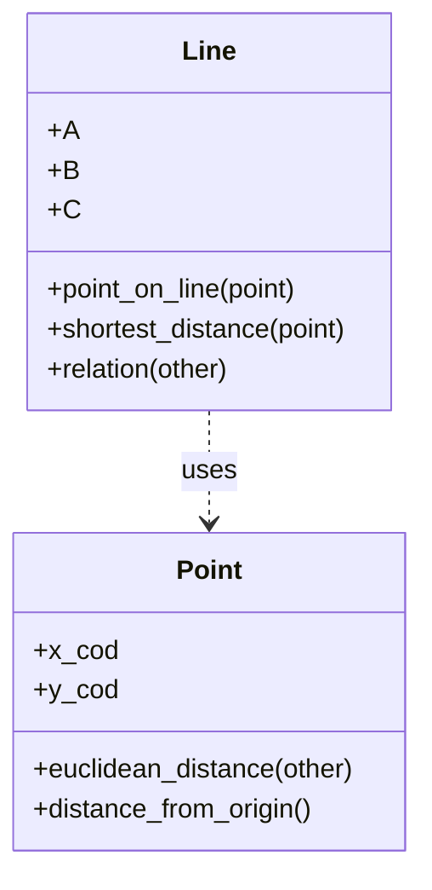

---

## 5. Accessing Attributes

```python
class Person:
    def __init__(self, name_input, country_input):
        self.name = name_input
        self.country = country_input

    def greet(self):
        if self.country == 'india':
            print('Namaste', self.name)
        else:
            print('Hello', self.name)

p = Person('Vishal', 'india')
print(p.name)          # Vishal
p.greet()              # Namaste Vishal

# You can add a new attribute from outside the class
p.gender = 'Male'
print(p.gender)        # Male
```

> The new attribute is added to the object `p` only. Other `Person` objects will not have `gender`.

---

## 6. Reference Variable (Memory Diagram)

> ❌ Common wrong idea: "In `p = Person()`, `p` is the object."
> ✅ Correct: `p` is only a **reference variable**. The real object lives in **heap memory**, and `p` stores its **address**.

```python
class Person:
    def __init__(self):
        self.name = 'vishal'
        self.age = 24

p = Person()
q = p                       # no new object is created, only the address is copied
print(id(p), id(q))         # same number twice

p.gender = "male"
print(p.gender)             # male
print(q.gender)             # male (same object)

p.name = 'Khusi'
print(p.name, q.name)       # Khusi Khusi
```

### Memory diagram: `p = Person()` then `q = p`

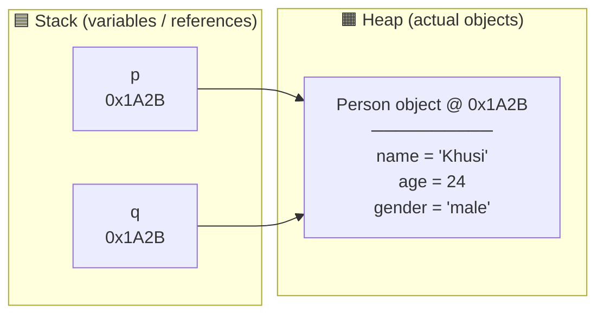

### What if `q` is given a new object?

```python
q = Person()     # q now points to a new object
```

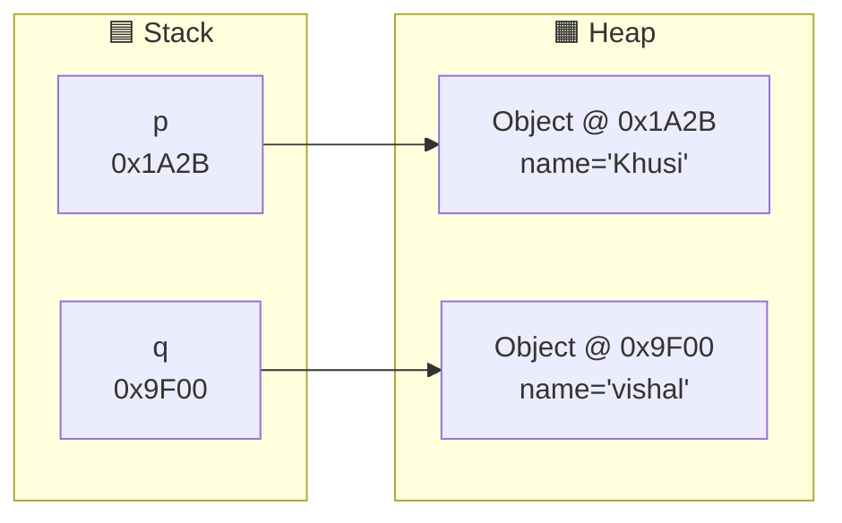

**Remember:** `q = p` copies the **address**, not the object.

---

## 7. Pass by Reference

In Python the exact rule is **pass by object reference**. The function receives the address of the object, not a copy of it.

### Case 1: Modify the object inside the function → the change is visible outside

```python
class Person:
    def __init__(self, name, gender):
        self.name = name
        self.gender = gender

def greet(person):
    person.name = "khusi"
    person.gender = "Female"
    print(person.name, person.gender)

p = Person("vishal", "male")
print(p.name, p.gender)     # vishal male
greet(p)                    # khusi Female
print(p.name, p.gender)     # khusi Female  ← the original object changed
```

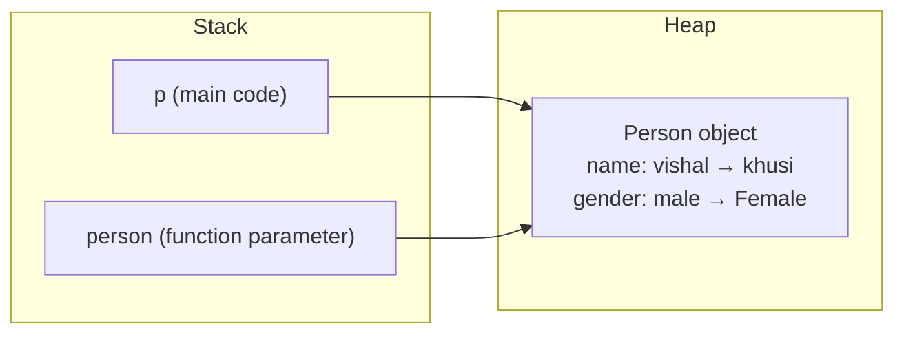

> Why: both `p` and `person` point to the **same mutable object**, so a change through one is seen through the other.

### Case 2: Assign a new object inside the function → outside is unchanged

```python
def greet(person):
    print(id(person))
    person = Person("krishna", "female")   # local variable now points to a new object
    return person

p = Person("vishal", "male")
print(id(p))
x = greet(p)
print(p.name)    # vishal   ← original is safe
print(x.name)    # krishna  ← new object came back through return
```

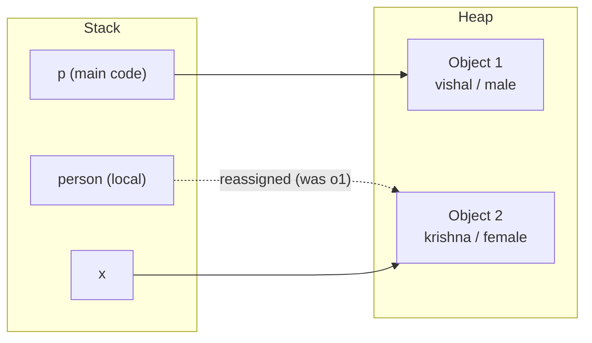

| Action inside the function | Visible outside? |
|---|---|
| `person.name = "x"` (change an attribute) | ✅ Yes |
| `person = Person(...)` (reassign the variable) | ❌ No |

---

## 8. Encapsulation

**Encapsulation** means keeping a class's data protected inside the class, so outside code cannot change it freely.

### The problem: public data

```python
class Atm:
    def __init__(self):
        self.pin = ''
        self.balance = 0     # public

obj = Atm()
obj.balance = "heeee"        # 😱 anyone can set anything
```

### The fix: a private attribute with `__` (double underscore)

```python
class Atm:
    def __init__(self):
        self.pin = ''
        self.__balance = 0   # private
```

```python
obj = Atm()
obj.balance = "heeee"        # this only creates a NEW attribute called 'balance'
                             # the real __balance is untouched
print(obj.__balance)         # ❌ AttributeError
```

### Name mangling (the reality)

Python's `__balance` is **not truly private**. Python renames it to `_Atm__balance` behind the scenes.

```python
obj._Atm__balance = "heee"   # ⚠️ this still works
```

> Python's philosophy is "we are all consenting adults." The `__` prefix is a strong warning, not a lock. Respecting it is the programmer's job.

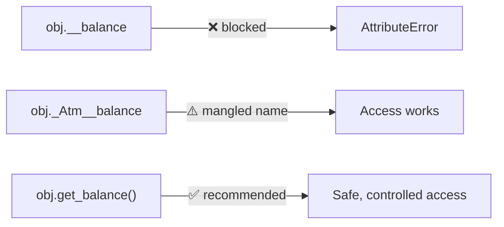

---

## 9. Getter and Setter

When data is private, you still need a controlled way to read and change it.

- **Getter**: reads the value
- **Setter**: changes the value (and can validate it first)

```python
class Account:
    def __init__(self):
        self.__balance = 0

    def get_balance(self):
        return self.__balance

    def set_balance(self, new_value):
        if isinstance(new_value, int) and new_value >= 0:   # ✅ validation
            self.__balance = new_value
        else:
            print("Invalid balance")

acc = Account()
acc.set_balance(10000)
print(acc.get_balance())    # 10000
acc.set_balance("abc")      # Invalid balance
```

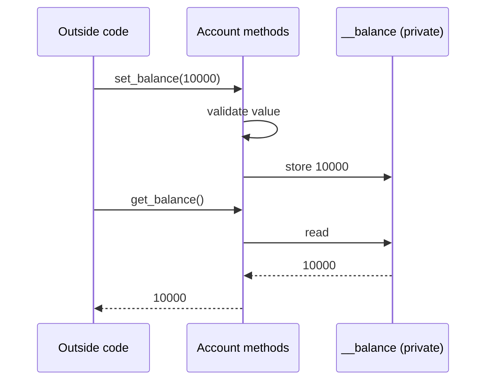

### 💡 The Pythonic way: `@property`

Most Python developers prefer `@property` over `get_x()` / `set_x()`.

```python
class Account:
    def __init__(self):
        self.__balance = 0

    @property
    def balance(self):
        return self.__balance

    @balance.setter
    def balance(self, value):
        if value >= 0:
            self.__balance = value

acc = Account()
acc.balance = 5000      # calls the setter
print(acc.balance)      # calls the getter
```

---

## 10. Objects in Collections

You can store objects in a list or a set.

```python
class Person:
    def __init__(self, name, gender):
        self.name = name
        self.gender = gender

obj1 = Person("Vishal", "Male")
obj2 = Person("Krishna", "Female")

l = [obj1, obj2]                 # list: keeps order
for i in l:
    print(i.name, i.gender)

s = {obj1, obj2}                 # set: objects are hashable by default (based on id), order not guaranteed
for i in s:
    print(i.name, i.gender)
```

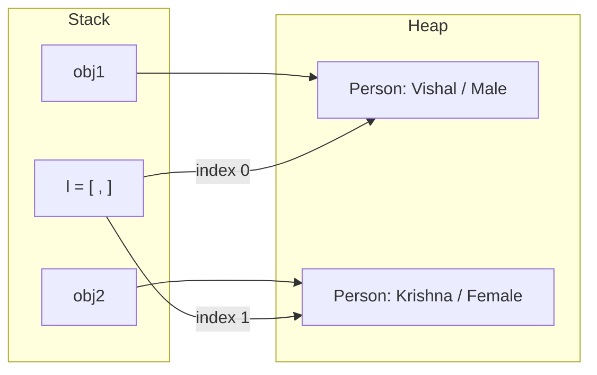

> A list stores **references**, not copies of the objects.

---

## 11. Class Variable (Static Variable)

- **Instance variable**: each object has its own copy (`self.name`)
- **Class variable**: one copy shared by all objects of the class

```python
class Person:
    __counter = 1                          # class variable (private)

    def __init__(self, name, gender):
        self.name = name
        self.gender = gender
        self.count = Person.__counter      # each object gets a unique number
        Person.__counter += 1

    @classmethod
    def get_counter(cls):                  # class-level getter
        return cls.__counter

p1 = Person("K", "M")
p2 = Person("E", "F")
p3 = Person("R", "G")

print(p1.count, p2.count, p3.count)   # 1 2 3
print(Person.get_counter())           # 4  (don't forget the brackets)
```

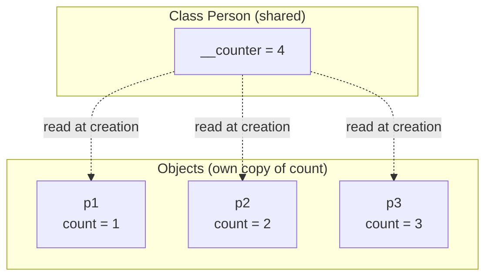

> `Person.counter = 'heee'` creates a **new** class attribute named `counter`. The private `__counter` (real name `_Person__counter`) is not affected.

---

## 12. Common Mistakes

| ❌ Mistake | ✅ Correct |
|---|---|
| Calling `L.upper()` on a list | `upper()` exists only on `str` |
| `def __mul__(self, *other)` | `def __mul__(self, other)` |
| Returning a string from `__add__` | Return a `Fraction` so you can chain operations |
| Calling `a₁/a₂ ≠ b₁/b₂` "parallel" | That means **intersecting**. Parallel needs `a₁/a₂ = b₁/b₂ ≠ c₁/c₂` |
| Comparing ratios with division | Cross-multiply: `a1*b2 == a2*b1` (avoids divide by zero) |
| Using a global variable (`p`) inside a function that takes a parameter | Use the parameter |
| "A class is mutable" | **Objects** are mutable, not classes |
| `person.get_class` without `()` | `person.get_class()` |
| Thinking `__balance` is truly private | It is name mangling. `_Atm__balance` still works |
| Thinking `obj.balance = x` changes the private value | It creates a new public attribute |
| No balance check in `withdraw` | `if amount <= self.balance` |
| Using `p1` or `l1` before creating them | Always create the object first |

---

## ✅ Quick Revision

- **Class** = blueprint. **Object** = real instance, stored in the heap.
- A **variable** is a reference (in the stack) that holds an object's address.
- `__init__` runs automatically when an object is created.
- `q = p` → one object, two references.
- Inside a function: **modifying** an object is visible outside, **reassigning** the variable is not.
- `__x` triggers name mangling. `@property` is the Pythonic getter/setter.
- A class variable is shared by all objects.

---

⭐ If these notes helped, give the repo a star!
