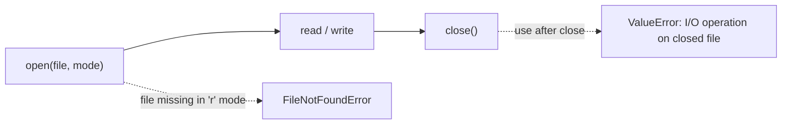
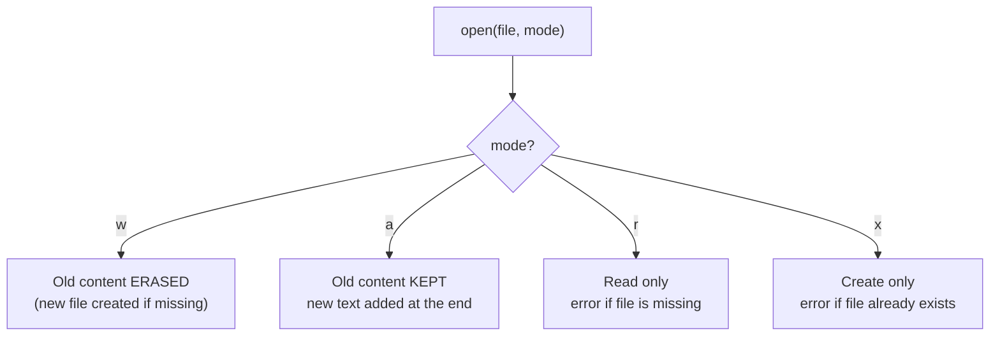
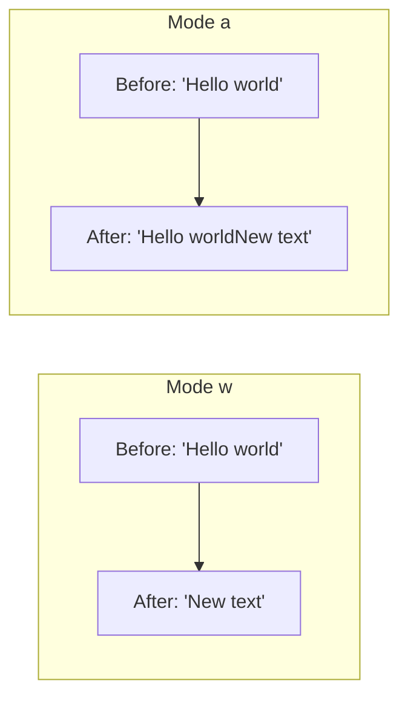
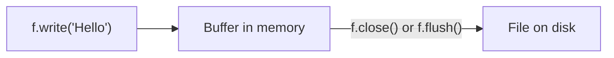
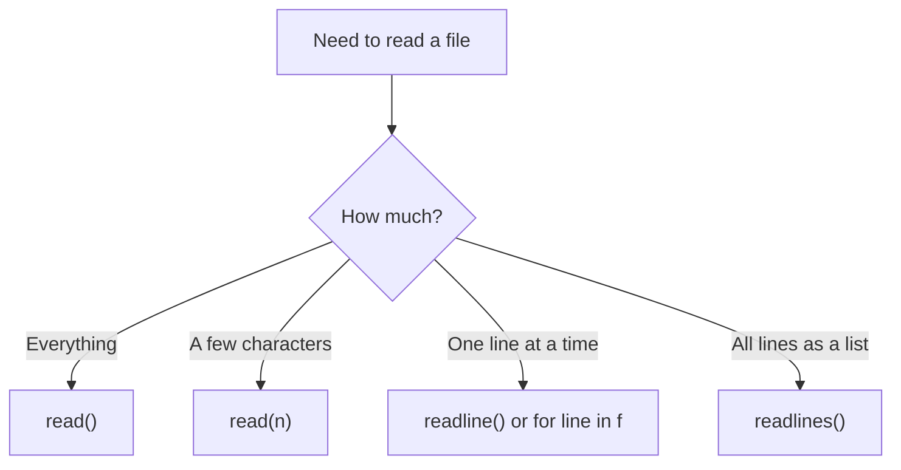
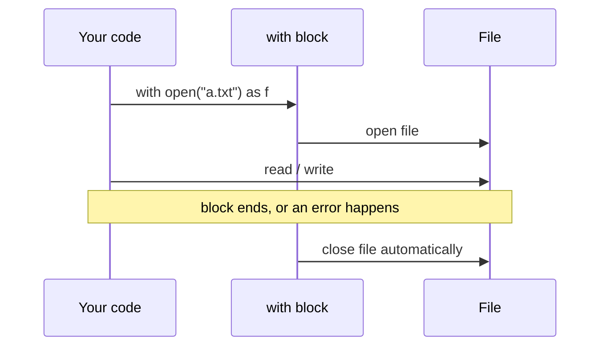
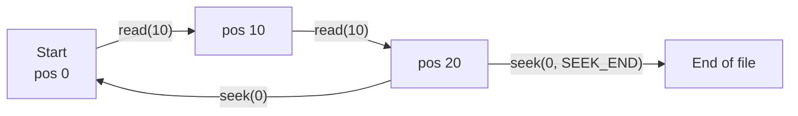
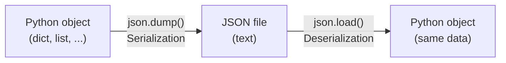
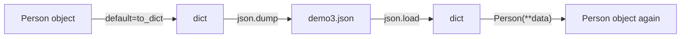

# 📂 Python File Handling Notes

> A simple guide to reading, writing and storing data in files with Python: file modes, `read` / `write`, the `with` statement, `tell` / `seek`, binary files, and JSON (serialization and deserialization).

## 📑 Table of Contents
1. [File Lifecycle](#1-file-lifecycle)
2. [File Modes](#2-file-modes)
3. [Writing to Files](#3-writing-to-files)
4. [Why We Close a File](#4-why-we-close-a-file)
5. [Reading from Files](#5-reading-from-files)
6. [The `with` Statement (Context Manager)](#6-the-with-statement-context-manager)
7. [`tell()` and `seek()`](#7-tell-and-seek)
8. [Binary Files](#8-binary-files)
9. [Only Strings Can Be Written](#9-only-strings-can-be-written)
10. [Serialization and Deserialization (JSON)](#10-serialization-and-deserialization-json)
11. [Serializing Custom Objects](#11-serializing-custom-objects)
12. [Common Mistakes](#12-common-mistakes)

---

## 1. File Lifecycle

Every file operation follows 3 steps: **open → read/write → close**.



```python
f = open("Sample.txt", "w")   # 1. open
f.write("Hello world")        # 2. write
f.close()                     # 3. close

f.write("more")               # ❌ ValueError: I/O operation on closed file
```

> After `close()`, you cannot read or write through that file object any more.

---

## 2. File Modes

| Mode | Meaning | If file exists | If file doesn't exist |
|------|---------|----------------|-----------------------|
| `r` | Read (default) | Opens it | ❌ `FileNotFoundError` |
| `w` | Write | ⚠️ **Erases old content** | Creates it |
| `a` | Append | Keeps content, adds at the **end** | Creates it |
| `x` | Create only | ❌ `FileExistsError` | Creates it |
| `r+` | Read and write | Keeps content | ❌ Error |
| `w+` | Read and write | ⚠️ Erases content | Creates it |
| `b` (add to any mode) | Binary, e.g. `rb`, `wb` | | |



---

## 3. Writing to Files

### `write()`: one string at a time

```python
f = open("Sample1.txt", "w")
f.write("Hello vishal\n")                       # \n = new line
f.write("Don't remember your past, it won't give you anything\n")
f.close()
```

`write()` does **not** add a new line for you. Add `\n` yourself.

### `"w"` mode overwrites everything

You cannot "edit" a file in `w` mode. Opening it erases the old content, and you start fresh.

```python
f = open("Sample.txt", "w")
f.write("You are the best version of your life")   # old "Hello world" is gone
f.close()
```

### `"a"` mode adds to the end

```python
f = open("Sample1.txt", "a")
f.write("Why do you think that will not happen in your life?")
f.close()
```



### `writelines()`: many strings at once

```python
L = ["Hi\n", "Vishal\n", "Don't remember your past\n", "It can't give you anything\n", "Except pain\n"]
f = open("Sample2.txt", "w")
f.writelines(L)          # does NOT add \n. Your strings must already have it
f.close()
```

> Using a **set** with `writelines()` works, but a set has **no fixed order**, so lines can be written in any order. Use a list when order matters.

```python
S = {"Hi\n", "Hello\n"}
with open("Sample3.txt", "w") as f:
    f.writelines(S)      # order not guaranteed
```

### Writing a dictionary

```python
D = {"Name": "Vishal", "Age": 23, "Gender": "Male"}
with open("Sample4.txt", "w") as f:
    f.write(str(D))      # saved as plain text: {'Name': 'Vishal', 'Age': 23, ...}
```

---

## 4. Why We Close a File

1. **Data is buffered.** `write()` first goes to a buffer in memory. Closing (or flushing) pushes it to disk. If the program crashes before that, you can lose data.
2. **It frees resources.** The operating system limits how many files can be open at once.
3. **Files can stay locked.** Other programs may not be able to use the file.



> If you forget to close, Python usually closes the file when the object is garbage collected. This is **not guaranteed**, so do not rely on it. Use `with` instead.

---

## 5. Reading from Files

Assume `Sample2.txt` contains:

```
Hi
Vishal
Don't remember your past
It can't give you anything
Except pain
```

| Method | What it does |
|--------|--------------|
| `read()` | Reads the **whole file** as one string |
| `read(n)` | Reads the next **n characters** |
| `readline()` | Reads **one line** |
| `readline(n)` | Reads **at most n characters** of the current line (not n lines) |
| `readlines()` | Reads all lines into a **list** |

```python
f = open("Sample2.txt", "r")
print(f.read())             # whole file
f.close()

f = open("Sample2.txt", "r")
print(f.read(7))            # "Hi\nVish" (7 characters, the \n counts as 1)
f.close()

f = open("Sample2.txt", "r")
print(f.readline(), end="")   # Hi
print(f.readline(), end="")   # Vishal
f.close()

f = open("Sample2.txt", "r")
print(f.readline(2))        # "Hi"  (only 2 characters, not 2 lines)
f.close()

with open("Sample2.txt") as f:
    lines = f.readlines()   # ['Hi\n', 'Vishal\n', ...]
print(lines[3])             # "It can't give you anything\n"
```

### Read a file line by line with a loop

```python
# Method 1: readline() in a while loop
f = open("Sample2.txt", "r")
while True:
    data = f.readline()
    if data == '':          # empty string means end of file
        break
    print(data, end="")
f.close()

# Method 2: loop over the file directly (best, memory friendly for big files)
with open("Sample2.txt") as f:
    for line in f:
        print(line, end="")
```



---

## 6. The `with` Statement (Context Manager)

`with` closes the file **automatically** as soon as the block ends, even if an error happens inside. It replaces `f.close()`.

```python
L = ["Hy\n", "Buddy\n", "I am the best way\n"]

with open("Sample3.txt", "w") as f:
    f.writelines(L)

with open("Sample3.txt", "r") as f:
    data = f.read()
    print(data)
# file is already closed here
```



```python
# Writing 100 lines quickly
L = ["Hello vishal \n" for i in range(100)]
with open("Sample4.txt", "w") as f:
    f.writelines(L)
```

> 💡 Good habit: add `encoding="utf-8"` so text with special characters works on every system:
> `open("file.txt", "w", encoding="utf-8")`

---

## 7. `tell()` and `seek()`

Python keeps a **file pointer**: the position where the next read or write happens.

| Method | Meaning |
|--------|---------|
| `f.tell()` | Returns the current pointer position (takes **no argument**) |
| `f.seek(pos)` | Moves the pointer to position `pos` |
| `f.seek(0, 2)` | Moves the pointer to the **end** of the file |

For `Sample3.txt` = `"Hy\nBuddy\nI am the best way\n"`:

```
Index :  0  1  2  3  4  5  6  7  8  9 | 10 11 12 13 14 15 16 17 18 19 | 20 ...
Char  :  H  y  \n B  u  d  d  y  \n I |  ␣  a  m  ␣  t  h  e  ␣  b  e |  s ...
         └──────── 1st read(10) ───────┘ └──────── 2nd read(10) ────────┘
tell() = 10 after the first read, 20 after the second
```

```python
import os

with open("Sample3.txt", "r") as f:
    print(f.read(10))          # "Hy\nBuddy\nI"
    print(f.tell())            # 10
    print(f.read(10))          # " am the be"  (continues, doesn't restart)
    print(f.tell())            # 20
    f.seek(0)                  # go back to the start
    print(f.read(10))          # "Hy\nBuddy\nI" again
    print(f.tell())            # 10
    print(f.seek(0, os.SEEK_END))   # jump to the end, returns the end position
```



> ⚠️ In **text mode**, `seek()` only allows an offset of `0` with `SEEK_CUR` / `SEEK_END`. For other offsets, use binary mode. Also, `tell()` in text mode is only guaranteed to work with `seek()`. Don't do math on it for files with special characters or Windows line endings.

### Seek and write

```python
with open("Sample.txt", "w") as f:
    f.write("Hello")
    f.seek(0)          # back to the start
    f.write("X")       # overwrites the first character
# File now contains: Xello
```

> In `"a"` mode, writes **always go to the end**, no matter where you `seek()`.

---

## 8. Binary Files

Images, videos, PDFs and audio are **binary** files. Use `rb` (read binary) and `wb` (write binary). You get `bytes` instead of `str`.

```python
# Copy an image
with open("photo.png", "rb") as src:
    with open("photo_copy.png", "wb") as dst:
        dst.write(src.read())
```

For **big files**, copy in chunks so you don't load the whole file into memory:

```python
import shutil

with open("video.mp4", "rb") as src, open("video_copy.mp4", "wb") as dst:
    shutil.copyfileobj(src, dst)
```

> Use relative paths like `"photo.png"` in code you push to GitHub. Paths such as `/content/...` only work inside Google Colab.

---

## 9. Only Strings Can Be Written

`write()` accepts **strings only**. Other types must be converted first.

```python
d = {"Name": "vishal", "Age": 23, "Class": "Ist"}

with open("Sample.txt", "w") as f:
    f.write(str(d))                  # saved as text

with open("Sample.txt", "r") as f:
    data = f.read()
    print(type(data))                # <class 'str'>, not a dict!
```

Converting the string back to a dict with `dict()` fails:

```python
dict(data)    # ❌ ValueError: dictionary update sequence element #0 has length 1; 2 is required
```

The fix is **JSON**.

> ⚠️ Careful: if you call `f.read()` twice, the second call returns `''` because the pointer is already at the end. `dict('')` then quietly returns `{}`, which looks like it "worked" but gives an empty dictionary.

---

## 10. Serialization and Deserialization (JSON)

| Term | Meaning | Python function |
|------|---------|-----------------|
| **Serialization** | Python object → JSON text | `json.dump()` / `json.dumps()` |
| **Deserialization** | JSON text → Python object | `json.load()` / `json.loads()` |

**JSON** (JavaScript Object Notation) is a simple text format for storing data, and almost every programming language can read it.



```python
import json

# Serialization: list → JSON file
L = [1, 2, 3, 4, 5]
with open("demo.json", "w") as f:
    json.dump(L, f)

# Serialization: dict → JSON file (indent makes it readable)
d = {
    "Name": "Vishal",
    "Age": 23,
    "Class": "Ist",
    "Marks": [100, 200, 300, 400]
}
with open("demo1.json", "w") as f:
    json.dump(d, f, indent=4)

# Deserialization: JSON file → Python object
with open("demo.json", "r") as f:
    print(json.load(f))        # [1, 2, 3, 4, 5]

with open("demo1.json", "r") as f:
    data = json.load(f)
    print(data["Name"])        # Vishal
```

### Python ↔ JSON type mapping

| Python | JSON |
|--------|------|
| `dict` | object `{}` |
| `list`, `tuple` | array `[]` |
| `str` | string |
| `int`, `float` | number |
| `True` / `False` | `true` / `false` |
| `None` | `null` |

### Things that change or fail

```python
# 1. Tuple becomes a list (JSON has no tuple)
t = (1, 2, 3, 4, 5, 6)
with open("demo2.json", "w") as f:
    json.dump(t, f)

with open("demo2.json", "r") as f:
    print(json.load(f))        # [1, 2, 3, 4, 5, 6]  ← list, not tuple

# 2. Dictionary keys become strings
json.loads(json.dumps({1: "a"}))   # {'1': 'a'}

# 3. Sets and custom objects are not supported
json.dumps({1, 2, 3})              # ❌ TypeError: Object of type set is not JSON serializable
```

---

## 11. Serializing Custom Objects

JSON doesn't know how to store your own classes. Without help, you get a `TypeError`. The `default=` argument tells `json.dump` how to convert an unknown object.

```python
import json

class Person:
    def __init__(self, fname, lname, age, gender):
        self.fname = fname
        self.lname = lname
        self.age = age
        self.gender = gender

p = Person("vishal", "saran", 25, "Male")
```

### Option A: Convert to a string (one way only)

```python
def show_object(obj):
    return f"{obj.fname} -> {obj.lname} is {obj.age} --> {obj.gender}"

with open("demo3.json", "w") as f:
    json.dump(p, f, default=show_object)
# File contains one string: "vishal -> saran is 25 --> Male"
```

This works for saving, but you **cannot rebuild the object** from that string.

### Option B: Convert to a dict (recommended, round trip works)

```python
def to_dict(obj):
    return obj.__dict__          # {'fname': 'vishal', 'lname': 'saran', ...}

with open("demo3.json", "w") as f:
    json.dump(p, f, default=to_dict, indent=4)

# Deserialize and rebuild the object
with open("demo3.json", "r") as f:
    data = json.load(f)          # a normal dict

p2 = Person(**data)
print(p2.fname, p2.age)          # vishal 25
```



> `pickle` can store almost any Python object, but never load a pickle file from an untrusted source, because it can run malicious code. JSON is safer and works across languages.

---

## 12. Common Mistakes

| ❌ Mistake | ✅ Correct |
|---|---|
| Thinking `"w"` mode edits an existing file | `"w"` **erases** it. Use `"a"` to add, or `"r+"` to edit |
| Using `f` after `f.close()` | Use `with` so you never have to remember |
| Forgetting `\n` in `write()` / `writelines()` | Python never adds it for you |
| Thinking `readline(2)` reads 2 lines | It reads at most 2 **characters** |
| `f.tell(10)` | `tell()` takes no argument. Use `seek(10)` to move |
| Calling `f.read()` twice and expecting the same data | The pointer is at the end after the first read. Use `f.seek(0)` first |
| `dict(f.read())` to restore a dict | Use `json.load(f)` |
| Writing a dict with `str(d)` and expecting valid JSON | `str(d)` uses single quotes. Use `json.dump` |
| Expecting a tuple back from JSON | You get a **list** |
| Using a set with `writelines()` and expecting order | Sets are unordered. Use a list |
| Leaving a bare line like `What is JSON?` in a `.py` file | Make it a comment: `# What is JSON?` |
| Importing unused or platform-specific names (`SEEK_DATA`, `IPython...Instance`) | Remove them. Use `os.SEEK_END` |
| Using `default=show_object` and expecting to load the object back | Return `obj.__dict__` and rebuild with `Person(**data)` |
| Opening files without `encoding` | `open(..., encoding="utf-8")` |

---

## ✅ Quick Revision

- Steps: **open → read/write → close**. Prefer `with`.
- `w` erases, `a` appends, `r` reads, `x` creates only.
- `read()` = all, `read(n)` = n characters, `readline()` = one line, `readlines()` = list of lines.
- `tell()` = where the pointer is, `seek()` = move the pointer.
- Binary files use `rb` / `wb`.
- Only strings go into text files. For dicts, lists and more, use **JSON**.
- `json.dump` / `json.load` work with files. `json.dumps` / `json.loads` work with strings.
- Custom objects need `default=` to save and `Class(**data)` to rebuild.

---

⭐ If these notes helped, give the repo a star!
