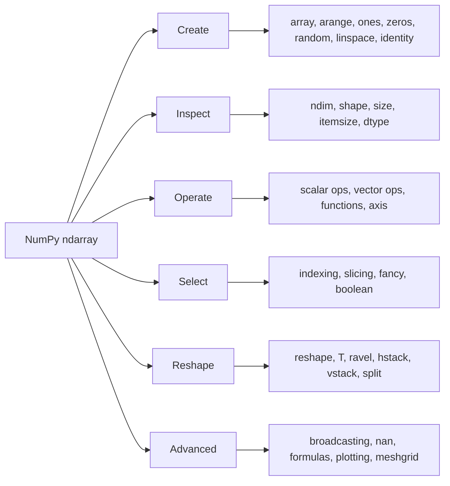
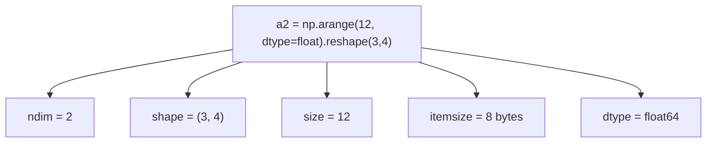
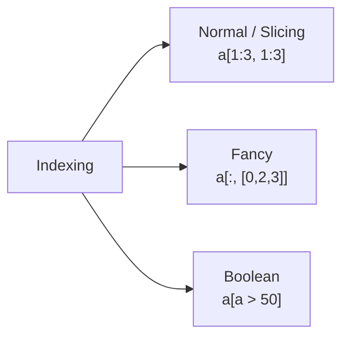
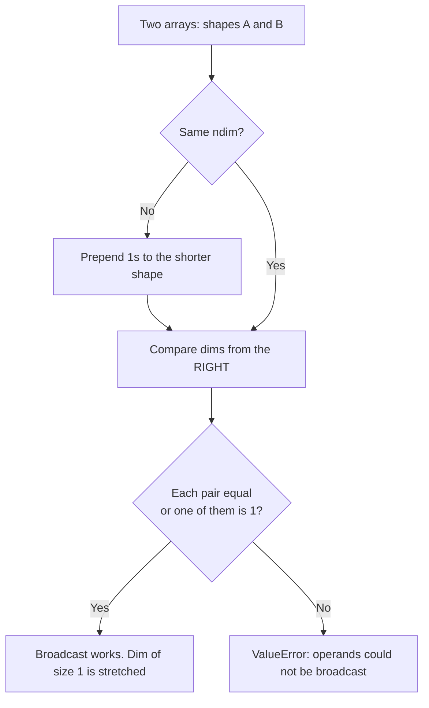

# NumPy Notes: Fundamentals + Advanced

Notes from **Session 13 (NumPy Fundamentals)** and **Session 14 (NumPy Advanced)**.
Every section has: concept → code → output → gotchas.

```python
import numpy as np
```

## Table of Contents

**Part 1: Fundamentals (Session 13)**
1. [What is NumPy?](#1-what-is-numpy)
2. [NumPy Arrays vs Python Lists](#2-numpy-arrays-vs-python-lists)
3. [Creating Arrays](#3-creating-arrays)
4. [Array Attributes](#4-array-attributes)
5. [Changing Data Type](#5-changing-data-type)
6. [Array Operations](#6-array-operations)
7. [Array Functions and the `axis` Concept](#7-array-functions-and-the-axis-concept)
8. [Indexing and Slicing](#8-indexing-and-slicing)
9. [Iterating](#9-iterating)
10. [Reshaping, Transpose, Ravel](#10-reshaping-transpose-ravel)
11. [Stacking and Splitting](#11-stacking-and-splitting)

**Part 2: Advanced (Session 14)**

12. [Speed and Memory: NumPy vs Lists](#12-speed-and-memory-numpy-vs-lists)
13. [Advanced Indexing (Fancy and Boolean)](#13-advanced-indexing)
14. [Broadcasting](#14-broadcasting)
15. [Mathematical Formulas in NumPy](#15-mathematical-formulas-in-numpy)
16. [Missing Values (`np.nan`)](#16-missing-values)
17. [Plotting Graphs](#17-plotting-graphs)
18. [Meshgrid](#18-meshgrid)
19. [Common Errors Cheat Sheet](#19-common-errors-cheat-sheet)
20. [Quick Reference](#20-quick-reference)

---

## Big Picture



---

# Part 1: Fundamentals

## 1. What is NumPy?

NumPy is the core package for scientific computing in Python. Its heart is the **`ndarray`**: an n-dimensional array of **homogeneous** (same type) elements.

It provides fast array operations: math, logic, sorting, shape manipulation, linear algebra, statistics, random numbers, Fourier transforms, I/O.

Pandas, SciPy, scikit-learn, Matplotlib and TensorFlow all use NumPy arrays internally.

## 2. NumPy Arrays vs Python Lists

| Feature | Python list | NumPy array |
|---|---|---|
| Size | Grows dynamically | Fixed at creation (resizing makes a *new* array) |
| Element types | Mixed allowed | **One** dtype for all |
| Speed | Slow (Python loop) | Fast (vectorized C code) |
| Memory | High (each item is a Python object) | Low (packed contiguous block) |
| Math on whole collection | Needs loops | `a + b` works directly |

```
Python list  →  [ ptr ][ ptr ][ ptr ] ... each ptr → separate int object elsewhere in memory
NumPy array  →  [ 1 ][ 2 ][ 3 ] ...     values stored side by side in one block
```

## 3. Creating Arrays

### `np.array`: from lists

```python
a = np.array([1, 2, 3])                      # 1D
b = np.array([[1, 2, 3], [4, 5, 6]])         # 2D
c = np.array([[[1, 2], [3, 4]],
              [[5, 6], [7, 8]]])             # 3D
np.array([1, 2, 3], dtype=float)             # array([1., 2., 3.])
```

```
1D  shape (3,)         2D  shape (2,3)         3D  shape (2,2,2)

[1 2 3]                [[1 2 3]                [[[1 2]  [3 4]]
                        [4 5 6]]                [[5 6]  [7 8]]]
```

### Other creators

| Function | Example | Result |
|---|---|---|
| `np.arange(start, stop, step)` | `np.arange(1, 11, 2)` | `[1 3 5 7 9]` (stop excluded) |
| `np.arange(16).reshape(2,2,2,2)` | 4D array | shape `(2,2,2,2)` |
| `np.ones(shape)` | `np.ones((3,4))` | 3×4 of `1.` |
| `np.zeros(shape)` | `np.zeros((3,4))` | 3×4 of `0.` |
| `np.random.random(shape)` | `np.random.random((3,4))` | floats in `[0, 1)` |
| `np.linspace(start, stop, num)` | `np.linspace(-10, 10, 10, dtype=int)` | `[-10 -7 -5 -3 -1 1 3 5 7 10]` |
| `np.identity(n)` | `np.identity(3)` | 3×3 identity matrix |

> **`arange` vs `linspace`:** `arange` takes a **step size** (stop excluded). `linspace` takes a **count** of points (stop **included**), evenly spaced.
>
> With `dtype=int`, `linspace` **truncates** toward zero (e.g. `-7.78 → -7`), it does not round.

```
np.identity(3)
[[1. 0. 0.]
 [0. 1. 0.]
 [0. 0. 1.]]
```

## 4. Array Attributes

```python
a1 = np.arange(10, dtype=np.int32)
a2 = np.arange(12, dtype=float).reshape(3, 4)
a3 = np.arange(8).reshape(2, 2, 2)
```

| Attribute | Meaning | Example |
|---|---|---|
| `ndim` | number of dimensions | `a3.ndim → 3` |
| `shape` | size along each dimension | `a3.shape → (2, 2, 2)` |
| `size` | total number of elements | `a2.size → 12` |
| `itemsize` | bytes per element | `a3.itemsize → 8` (int64) |
| `dtype` | data type | `a1.dtype → int32`, `a2.dtype → float64` |



> `itemsize` depends on the platform default. `int64` is 8 bytes on most 64-bit Linux/Mac setups. On older Windows setups the default int can be `int32` (4 bytes).

## 5. Changing Data Type

```python
a3.astype(np.int32)   # returns a NEW array, original unchanged
```

`astype` always makes a copy. Use it to save memory (`int64 → int32`) or to convert types.

## 6. Array Operations

```python
a1 = np.arange(12).reshape(3, 4)
a2 = np.arange(12, 24).reshape(3, 4)
```

### Scalar operations (array with a single number)

```python
a1 ** 2      # square every element
a2 == 15     # relational → boolean array
```

```
a2 == 15
[[False False False False]
 [False False False False]
 [False False False False]]   # 15 lives at a2[0,3] → True there
```

(Correction: `a2` starts at 12, so `a2[0,3] = 15` is `True`; every other cell is `False`.)

### Vector operations (array with array, element by element)

```python
a1 ** a2     # each element of a1 raised to the matching element of a2
```

Shapes must match, or be **broadcast-compatible** (see [Broadcasting](#14-broadcasting)).

> Careful: `a1 ** a2` with large values overflows `int64` silently. NumPy does not raise an error, you just get wrong numbers.

## 7. Array Functions and the `axis` Concept

```python
a1 = np.round(np.random.random((3, 3)) * 100)
```

| Category | Functions |
|---|---|
| Aggregates | `np.max`, `np.min`, `np.sum`, `np.prod` |
| Statistics | `np.mean`, `np.median`, `np.std`, `np.var` |
| Trigonometric | `np.sin`, `np.cos`, `np.tan` |
| Exponent / log | `np.exp`, `np.log` |
| Rounding | `np.round`, `np.floor`, `np.ceil` |
| Linear algebra | `np.dot` |

### The `axis` rule

> **`axis=0` → collapse the rows (move *down*) → one result per *column*.**
> **`axis=1` → collapse the columns (move *across*) → one result per *row*.**

```
            axis=1 →
          c0  c1  c2
axis=0 r0 [ 1   2   3 ]
   ↓   r1 [ 4   5   6 ]
       r2 [ 7   8   9 ]

np.sum(a, axis=0) → [12 15 18]    (column totals)
np.sum(a, axis=1) → [ 6 15 24]    (row totals)
np.sum(a)         → 45            (no axis = everything)
```

The shorthand "0 → col, 1 → row" means *the result is per column / per row*. The axis name is the dimension that **disappears**.

```python
np.prod(a1, axis=0)   # product of each column
np.var(a1, axis=1)    # variance of each row
```

### Dot product (matrix multiplication)

```python
a2 = np.arange(12).reshape(3, 4)
a3 = np.arange(12, 24).reshape(4, 3)
np.dot(a2, a3)        # shape (3, 3)
```

```
(3 x 4) · (4 x 3) → (3 x 3)
      ↑___↑ inner dims must match; outer dims form the result
```

### Rounding

```python
np.ceil(np.random.random((2, 3)) * 100)   # round UP
# np.floor → round DOWN,  np.round → nearest
```

## 8. Indexing and Slicing

Slice syntax: `start:stop:step` (stop excluded), applied per axis, separated by commas.

```python
a1 = np.arange(10)                    # [0 1 2 3 4 5 6 7 8 9]
a2 = np.arange(12).reshape(3, 4)
a3 = np.arange(8).reshape(2, 2, 2)
```

```
a2 =  col→  0   1   2   3
      row0 [ 0   1   2   3 ]
      row1 [ 4   5   6   7 ]
      row2 [ 8   9  10  11 ]
```

### 1D

```python
a1[2:5:2]      # [2 4]
```

### 2D

| Code | Result | Meaning |
|---|---|---|
| `a2[1, 0]` | `4` | row 1, col 0 |
| `a2[0, :]` | `[0 1 2 3]` | whole row 0 |
| `a2[:, 2]` | `[2 6 10]` | whole column 2 |
| `a2[0:2, 1::2]` | `[[1 3] [5 7]]` | rows 0-1, cols 1 and 3 |
| `a2[::2, 1::2]` | `[[1 3] [9 11]]` | every 2nd row, every 2nd col from 1 |
| `a2[1, ::3]` | `[4 7]` | row 1, every 3rd element |
| `a2[1:, 1:3]` | `[[5 6] [9 10]]` | rows 1+, cols 1-2 |

### 3D

Think of a 3D array as **blocks → rows → columns**, so `a3[block, row, col]`.

```
a3 = np.arange(8).reshape(2,2,2)

block 0: [[0 1]    block 1: [[4 5]
          [2 3]]             [6 7]]

a3[1, 0, 1] → block 1, row 0, col 1 → 5
a3[1, 1, 0] → block 1, row 1, col 0 → 6
```

```python
a3 = np.arange(27).reshape(3, 3, 3)
a3[::2, 0, ::2]    # [[ 0  2] [18 20]]   blocks 0 & 2, row 0, cols 0 & 2
a3[2, 1:, 1:]      # [[22 23] [25 26]]
a3[0, 1, :]        # [3 4 5]
```

> **Slices are views, not copies.** Modifying a slice modifies the original. Use `.copy()` to detach.

## 9. Iterating

```python
for i in a1: print(i)            # each element
for i in a2: print(i)            # each ROW (a 1D array)
for i in a3: print(i)            # each 2D BLOCK
for i in np.nditer(a3): print(i) # every single ELEMENT, any dimension
```

| Loop target | Gives you |
|---|---|
| 1D array | scalars |
| 2D array | rows |
| 3D array | 2D blocks |
| `np.nditer(arr)` | every scalar, regardless of dimensions |

> A plain `for` loop in NumPy is almost always the wrong tool. Prefer vectorized operations.

## 10. Reshaping, Transpose, Ravel

```python
a2.reshape(4, 3)          # same data, new shape (total size must match)
np.transpose(a2)          # swap rows and columns
a2.T                      # shorthand for transpose
a3.ravel()                # flatten to 1D
```

```
a2 (3,4)              a2.T (4,3)
[[0 1 2 3]            [[0 4  8]
 [4 5 6 7]     →       [1 5  9]
 [8 9 10 11]]          [2 6 10]
                       [3 7 11]]
```

Tip: `reshape(-1, 3)` lets NumPy compute the `-1` dimension for you.

## 11. Stacking and Splitting

```python
a4 = np.arange(12).reshape(3, 4)
a5 = np.arange(12, 24).reshape(3, 4)
```

### Stacking (join)

```python
np.hstack((a4, a5))   # side by side → shape (3, 8)
np.vstack((a4, a5))   # on top       → shape (6, 4)
```

```
hstack: [ a4 | a5 ]          vstack: [  a4  ]
                                     [  a5  ]
```

- `hstack` needs the **same number of rows**.
- `vstack` needs the **same number of columns**.
- Note the double parentheses: you pass **one tuple** of arrays.

### Splitting (cut)

```python
np.hsplit(a4, 2)   # 2 pieces, each (3, 2)
np.hsplit(a4, 4)   # 4 pieces, each (3, 1)
np.vsplit(a5, 3)   # 3 pieces, each (1, 4)
```

The split count must **divide the dimension evenly**. `np.hsplit(a4, 5)` on 4 columns raises `ValueError: array split does not result in an equal division`.

---

# Part 2: Advanced

## 12. Speed and Memory: NumPy vs Lists

### Speed

```python
import time

# Python list: loop over 10 million items
a = [i for i in range(10_000_000)]
b = [i for i in range(10_000_000, 20_000_000)]
c = []
start = time.time()
for i in range(len(a)):
    c.append(a[i] + b[i])
print(time.time() - start)        # ~3.26 s

# NumPy: one vectorized operation
a = np.arange(10_000_000)
b = np.arange(10_000_000, 20_000_000)
start = time.time()
c = a + b
print(time.time() - start)        # ~0.06 s
```

Speed-up in the session: `3.26 / 0.06 ≈ 54x`. Exact numbers change with your machine.

Why NumPy wins:
1. **Vectorization:** the loop runs in compiled C, not Python.
2. **Contiguous memory:** CPU cache-friendly.
3. **Single dtype:** no per-element type checks.

### Memory

```python
import sys
a = [i for i in range(10_000_000)]
sys.getsizeof(a)                                   # ~80 MB, pointers only

a = np.arange(10_000_000, dtype=np.int8)
sys.getsizeof(a)                                   # ~10 MB (1 byte x 10M)
```

> **Unfair comparison warning:** the list was `int` (Python objects) and the array was `int8`. Also, `sys.getsizeof(list)` counts only the list's pointer array, **not** the int objects inside it, so the real list cost is even higher.
> `int8` only holds -128 to 127, so values up to 10 million **overflow**. For a fair test use `np.arange(10_000_000)` (int64, ~80 MB). NumPy still wins on speed, and wins on memory when you pick a smaller dtype that fits your data.

## 13. Advanced Indexing



### Normal

```python
a = np.arange(24).reshape(6, 4)
a[1, 2]          # 6
a[1:3, 1:3]      # [[5 6] [9 10]]
```

### Fancy indexing: pass a **list of indices**

```python
a[:, [0, 2, 3]]   # pick columns 0, 2, 3 (any order, repeats allowed)
a[[0, 2, 5]]      # pick rows 0, 2, 5
```

Unlike slicing, fancy indexing can select **non-uniform** positions, and returns a **copy**.

### Boolean indexing: pass a **True/False mask**

```python
a = np.random.randint(1, 100, 24).reshape(6, 4)

a[a > 50]                        # all numbers > 50
a[a % 2 == 0]                    # all even numbers
a[(a > 50) & (a % 2 == 0)]       # > 50 AND even
a[~(a % 7 == 0)]                 # NOT divisible by 7
```

```
a > 50          →  mask of True/False, same shape as a
a[mask]         →  1D array of only the True positions
```

| Operator | Meaning | Python keyword (does NOT work) |
|---|---|---|
| `&` | AND | `and` |
| `\|` | OR | `or` |
| `~` | NOT | `not` |

> **Parentheses are mandatory:** `a[(a > 50) & (a % 2 == 0)]`. Without them, `&` binds tighter than `>` and you get an error.

## 14. Broadcasting

Broadcasting is how NumPy does arithmetic between arrays of **different shapes**. The smaller array is virtually "stretched" to match the larger one, **without copying data**.

```python
a = np.arange(6).reshape(2, 3)     # (2,3)
b = np.arange(3).reshape(1, 3)     # (1,3)
a + b
```

```
 a (2,3)         b (1,3) stretched to (2,3)       result
[[0 1 2]    +    [[0 1 2]                    =    [[0 2 4]
 [3 4 5]]         [0 1 2]]                         [3 5 7]]
```

### The two rules

1. **Pad:** if the arrays have different `ndim`, add dimensions of size 1 on the **left** of the smaller one.
2. **Match:** compare shapes dimension by dimension from the **right**. Each pair must be **equal**, or one of them must be **1** (that one is stretched). Otherwise → `ValueError`.



### Worked examples (all from the session)

| `a` shape | `b` shape | After padding | Result shape | Works? |
|---|---|---|---|---|
| (2,3) | (2,3) | same | (2,3) | ✅ |
| (2,3) | (1,3) | same | (2,3) | ✅ |
| (4,3) | (3,) | (4,3) vs (1,3) | (4,3) | ✅ |
| (3,4) | (3,) | (3,4) vs (1,3) → 4 vs 3 | none | ❌ |
| (1,3) | (3,1) | same | (3,3) | ✅ outer sum |
| (1,3) | (4,1) | same | (4,3) | ✅ |
| (1,) | (2,2) | (1,1) vs (2,2) | (2,2) | ✅ |
| (3,4) | (4,3) | same | none | ❌ 3≠4, 4≠3 |
| (4,4) | (2,2) | same | none | ❌ 4≠2 |

```python
# (4,3) + (3,)  → row vector added to every row
a = np.arange(12).reshape(4, 3)
b = np.arange(3)
a + b

# (1,3) + (3,1) → both stretch → 3x3 grid
a = np.arange(3).reshape(1, 3)
b = np.arange(3).reshape(3, 1)
a + b
# [[0 1 2]
#  [1 2 3]
#  [2 3 4]]
```

```
(1,3) + (3,1) → (3,3)

 [0 1 2]      [0]        [0 1 2]   [0 0 0]     [0 1 2]
 stretched ↓  stretched→ [0 1 2] + [1 1 1]  =  [1 2 3]
              [1]        [0 1 2]   [2 2 2]     [2 3 4]
              [2]
```

> **Correction to the session comment:** `np.array([1])` has shape `(1,)`, not `(1,1)`. Rule 1 pads it to `(1,1)` automatically, which is why it still broadcasts against `(2,2)`.

**Real use:** subtract the column mean from every column (`X - X.mean(axis=0)`), normalise data, build distance tables.

## 15. Mathematical Formulas in NumPy

Because NumPy functions are vectorized, you can write formulas on whole arrays with no loops.

### Sigmoid

$$\sigma(x) = \frac{1}{1 + e^{-x}}$$

```python
def sigmoid(array):
    return 1 / (1 + np.exp(-array))

sigmoid(np.arange(100))   # squashes values into (0, 1)
```

### Mean Squared Error (MSE)

$$MSE = \frac{1}{n}\sum_{i=1}^{n}(y_i - \hat{y}_i)^2$$

```python
actual    = np.random.randint(1, 50, 25)
predicted = np.random.randint(1, 50, 25)

def mse(actual, predicted):
    return np.mean((actual - predicted) ** 2)

mse(actual, predicted)
```

### Binary Cross Entropy (BCE)

$$BCE = -\frac{1}{n}\sum_{i=1}^{n}\left[y_i\log(\hat{y}_i) + (1-y_i)\log(1-\hat{y}_i)\right]$$

> **Bug in the session notebook:** the cell labelled "binary cross entropy" just re-runs the MSE line. A correct version:

```python
def bce(actual, predicted):
    # actual in {0,1}, predicted in (0,1)
    return -np.mean(actual * np.log(predicted) +
                    (1 - actual) * np.log(1 - predicted))
```

Also: the random `actual`/`predicted` arrays above are integers 1–49, which is invalid input for BCE.

## 16. Missing Values

`np.nan` = "Not a Number", a float placeholder for missing data.

```python
a = np.array([1, 2, 3, 4, np.nan, 6])
a[~np.isnan(a)]            # [1. 2. 3. 4. 6.]  → drop the NaNs
```

| Fact | Detail |
|---|---|
| Check for NaN | `np.isnan(a)` (never `a == np.nan`, it's always `False`) |
| Array becomes float | NaN is a float, so the whole array turns `float64` |
| Aggregates spread NaN | `np.sum(a)` → `nan`. Use `np.nansum`, `np.nanmean` to skip NaNs |

## 17. Plotting Graphs

```python
import matplotlib.pyplot as plt

x = np.linspace(-10, 10, 100)    # 100 evenly spaced points
```

Pattern: **make `x` with `linspace`, compute `y` with a vectorized formula, `plt.plot(x, y)`.**

| Graph | `y =` | Shape |
|---|---|---|
| Line | `x` | straight diagonal |
| Parabola | `x ** 2` | U-shape |
| Sine | `np.sin(x)` | repeating wave |
| x·log(x) | `x * np.log(x)` | see warning below |
| Sigmoid | `1 / (1 + np.exp(-x))` | S-curve from 0 to 1 |

```python
x = np.linspace(-10, 10, 100)
plt.plot(x, x ** 2)
plt.show()
```

```
Sigmoid                       Parabola
 1 |           ________        |\           /|
   |         /                 | \         / |
.5 |-------+--                 |  \_     _/  |
   |      /                    |    \___/    |
 0 |_____/                     +-------------+
   -10    0    10                -10   0   10
```

> **Bug alert:** `np.log(x)` is undefined for `x ≤ 0`. With `x` from -10 to 10 you get `RuntimeWarning` and `nan` for the negative half, so the plot shows only the right side. Use `np.linspace(0.01, 10, 100)` for a clean curve.

## 18. Meshgrid

The session ended with an empty "Meshgrid" heading. Completing it, because it is the natural next step after broadcasting.

`np.meshgrid` turns two 1D coordinate arrays into two 2D grids, so you can evaluate a function of **two variables** `f(x, y)` over every (x, y) pair.

```python
x = np.linspace(-2, 2, 5)
y = np.linspace(-2, 2, 5)
xx, yy = np.meshgrid(x, y)       # both shape (5, 5)

z = xx ** 2 + yy ** 2            # f(x,y) = x² + y², no loops

plt.contourf(xx, yy, z)          # 2D heat/contour plot
plt.colorbar()
plt.show()
```

```
x = [1 2 3]    y = [10 20]

xx = [[1 2 3]      yy = [[10 10 10]
      [1 2 3]]           [20 20 20]]

Each (xx[i,j], yy[i,j]) is one grid point.
```

---

## 19. Common Errors Cheat Sheet

| Error / symptom | Cause | Fix |
|---|---|---|
| `operands could not be broadcast together` | Shapes fail the broadcasting rules | Check shapes from the right; `reshape` or add an axis with `a[:, None]` |
| `cannot reshape array of size X into shape ...` | Product of new shape ≠ size | Make the shape multiply to `size` |
| `array split does not result in an equal division` | `hsplit`/`vsplit` count doesn't divide the dimension | Use a divisor of the dimension |
| `vstack`/`hstack` takes 1 positional argument | Forgot the tuple | `np.vstack((a, b))` |
| `ValueError: truth value of an array is ambiguous` | Used `and`/`or` on arrays | Use `&`, `\|` with parentheses |
| Slice change altered original | Slices are **views** | `.copy()` |
| Overflow gives wrong numbers silently | dtype too small (`int8`) or huge powers | Use a larger dtype |
| `nan` in results | Missing data or `log` of ≤ 0 | `np.isnan`, `np.nan*` functions, fix the domain |

## 20. Quick Reference

```python
# Create
np.array / arange / linspace / ones / zeros / identity / random.random / random.randint

# Inspect
a.ndim  a.shape  a.size  a.itemsize  a.dtype

# Convert
a.astype(np.float32)

# Aggregate (use axis=0 for per-column, axis=1 for per-row)
np.sum  np.prod  np.mean  np.median  np.std  np.var  np.max  np.min

# Select
a[i, j]   a[r0:r1, c0:c1]   a[:, [0, 2]]   a[a > 5]   a[(a > 5) & (a < 9)]

# Shape
a.reshape()  a.T  a.ravel()  np.hstack  np.vstack  np.hsplit  np.vsplit

# Advanced
broadcasting rules  np.nan / np.isnan  np.meshgrid  plt.plot
```

---

## How to use this repo

1. Open the original notebooks in Colab (see the headers of the session files).
2. Run each code block while reading the matching section.
3. Change the numbers and predict the output **before** running. That is what builds intuition for shapes and `axis`.

## Practice Ideas

- Normalise a 5×4 random matrix column-wise using broadcasting.
- From a 6×4 random integer array, extract values that are odd **and** greater than 30.
- Implement `bce` correctly and compare with `mse` on the same predictions.
- Plot `z = sin(x) * cos(y)` with `meshgrid`.
