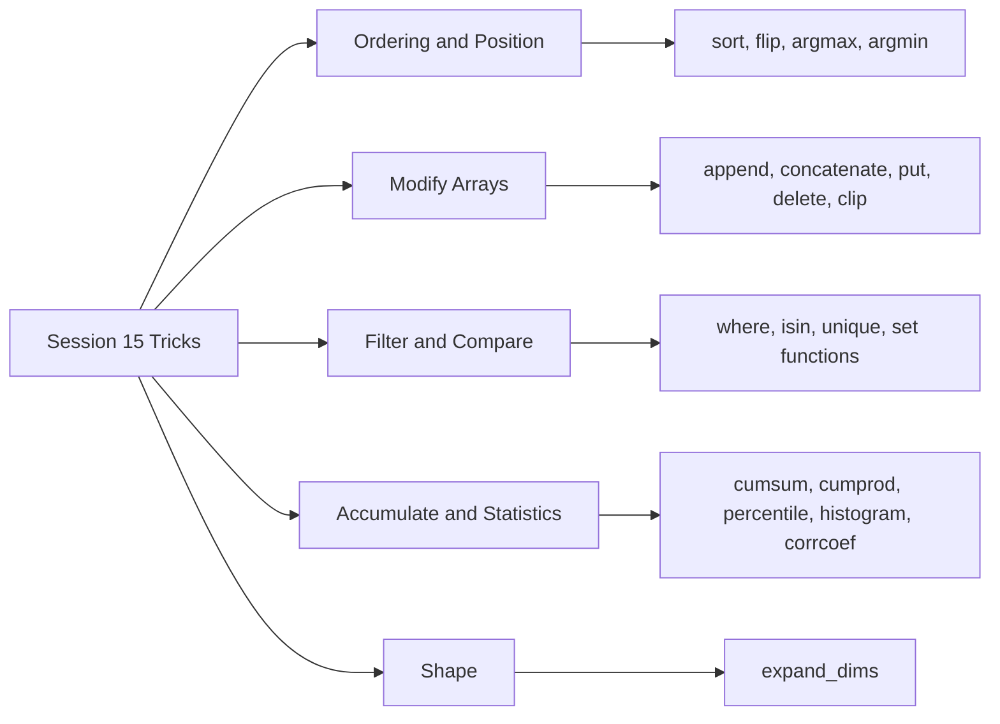
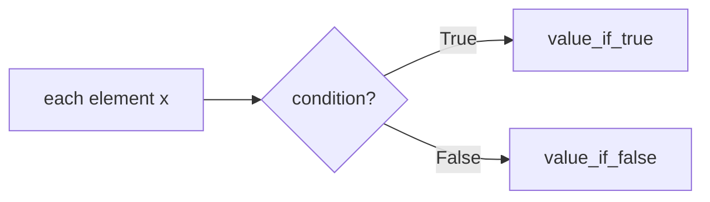

# NumPy Session 15: Useful Functions and Tricks

Notes for **Session 15**. Each function has: what it does → example → output → gotchas.

```python
import numpy as np

a = np.random.randint(1, 100, 15)               # 1D, 15 numbers
b = np.random.randint(1, 100, 24).reshape(6, 4) # 2D, 6 rows x 4 cols
```

> Random values change on every run. Outputs below use small fixed arrays so you can verify by hand.

## Table of Contents

1. [Function Map](#function-map)
2. [Copy vs In-place (read this first)](#copy-vs-in-place)
3. [np.sort](#1-npsort)
4. [np.append](#2-npappend)
5. [np.concatenate](#3-npconcatenate)
6. [np.unique](#4-npunique)
7. [np.expand_dims](#5-npexpand_dims)
8. [np.where](#6-npwhere)
9. [np.argmax / np.argmin](#7-npargmax--npargmin)
10. [np.cumsum / np.cumprod](#8-npcumsum--npcumprod)
11. [np.percentile](#9-nppercentile)
12. [np.histogram](#10-nphistogram)
13. [np.corrcoef](#11-npcorrcoef)
14. [np.isin](#12-npisin)
15. [np.flip](#13-npflip)
16. [np.put](#14-npput)
17. [np.delete](#15-npdelete)
18. [Set Functions](#16-set-functions)
19. [np.clip](#17-npclip)
20. [Pending Topics (completed)](#18-pending-topics-from-the-notebook)
21. [Common Mistakes](#common-mistakes)
22. [Quick Reference](#quick-reference)

---

## Function Map



## Copy vs In-place

This is the biggest source of bugs with these functions.

| Function | Returns | Changes original? |
|---|---|---|
| `np.sort` | new sorted array | No |
| `np.append` | new array | No |
| `np.concatenate` | new array | No |
| `np.delete` | new array | No |
| `np.where` | new array (or index tuple) | No |
| `np.clip` | new array | No |
| `np.flip` | **view** (same memory) | No, but writes through the view change the original |
| **`np.put`** | `None` | **Yes, modifies in place** |

If you write `np.append(a, 200)` and don't assign the result, nothing is saved:

```python
a = np.append(a, 200)   # correct
```

---

## 1. `np.sort`

Returns a **sorted copy**. Default: ascending, along the last axis.

```python
x = np.array([40, 10, 30, 20])
np.sort(x)          # [10 20 30 40]
np.sort(x)[::-1]    # [40 30 20 10]   descending trick: sort, then reverse
```

2D sorting with `axis`:

```python
m = np.array([[9, 2, 7],
              [4, 8, 1],
              [6, 3, 5]])

np.sort(m, axis=0)   # sort each COLUMN (top to bottom)
# [[4 2 1]
#  [6 3 5]
#  [9 8 7]]

np.sort(m, axis=1)   # sort each ROW (default)
# [[2 7 9]
#  [1 4 8]
#  [3 5 6]]
```

> `np.sort(b, axis=0)` sorts every column **independently**, so rows are no longer intact records. If your rows are records (name, marks, age), this destroys them. Use `np.argsort` on one column to reorder whole rows instead:
> `m[np.argsort(m[:, 0])]`

In-place version: `x.sort()` (modifies `x`, returns `None`).

## 2. `np.append`

Adds values at the end. Returns a **new** array.

```python
np.append(a, 200)            # adds 200 at the end of 1D array
```

For 2D, **`axis` matters**:

```python
b = np.array([[1, 2], [3, 4]])
col = np.array([[10], [20]])

np.append(b, col, axis=1)
# [[ 1  2 10]
#  [ 3  4 20]]
```

Notebook example: `np.append(b, np.random.random((b.shape[0], 1)), axis=1)` adds a new random column to a 6×4 array, giving 6×5. `b.shape[0]` makes the new column's length equal to the number of rows.

```
 b (6,4)        new col (6,1)        result (6,5)
[ . . . . ]  +  [ r ]           =   [ . . . . r ]
```

> **Gotcha:** without `axis`, `np.append` **flattens** everything to 1D. Also, `np.append` copies the whole array each time, so using it in a loop is slow. Collect into a Python list and convert once.

## 3. `np.concatenate`

Joins a sequence of arrays along an **existing** axis. Pass them as one tuple.

```python
c = np.arange(6).reshape(2, 3)       # [[0 1 2] [3 4 5]]
d = np.arange(6, 12).reshape(2, 3)   # [[6 7 8] [9 10 11]]

np.concatenate((c, d), axis=0)       # stack vertically → (4, 3)
# [[ 0  1  2]
#  [ 3  4  5]
#  [ 6  7  8]
#  [ 9 10 11]]

np.concatenate((c, d), axis=1)       # side by side → (2, 6)
# [[ 0  1  2  6  7  8]
#  [ 3  4  5  9 10 11]]
```

```
axis=0:  [ c ]        axis=1:  [ c | d ]
         [ d ]
```

> Rule: all dimensions **except** the joining axis must match. `concatenate` with `axis=0` = `vstack`, with `axis=1` = `hstack` (for 2D).
> `np.append(x, y, axis=k)` is essentially `np.concatenate((x, y), axis=k)`. Prefer `concatenate`; it is clearer and handles many arrays.

## 4. `np.unique`

Returns the **sorted unique** values.

```python
e = np.array([1, 1, 2, 2, 3, 3, 4, 4, 5, 5, 6, 6])
np.unique(e)                          # [1 2 3 4 5 6]

x = np.array([3, 1, 3, 2, 1, 3])
np.unique(x, return_counts=True)
# (array([1, 2, 3]), array([2, 1, 3]))    value 3 appears 3 times
```

Useful flags: `return_counts=True` (frequency), `return_index=True` (first position of each value).

> The output is **sorted**, not in order of first appearance.

## 5. `np.expand_dims`

Inserts a new axis of size 1. Same data, new shape.

```python
a.shape                               # (15,)
np.expand_dims(a, axis=0).shape       # (1, 15)   row vector
np.expand_dims(a, axis=1).shape       # (15, 1)   column vector
```

```
a (3,)  = [1 2 3]

axis=0 → (1,3)  [[1 2 3]]

axis=1 → (3,1)  [[1]
                 [2]
                 [3]]
```

Why it matters: it makes arrays **broadcast-compatible** (see session 14), and many ML libraries expect 2D input. Shortcut: `a[:, None]` is the same as `expand_dims(a, 1)`.

## 6. `np.where`

Two uses.

### (a) One argument → indices where the condition is True

```python
x = np.array([10, 60, 30, 80, 55])
np.where(x > 50)
# (array([1, 3, 4]),)      ← a TUPLE of index arrays
```

For 2D it returns `(row_indices, col_indices)`.

### (b) Three arguments → `np.where(condition, if_true, if_false)`, an element-wise if/else

```python
np.where(x > 50, 0, x)        # replace values > 50 with 0  → [10  0 30  0  0]
np.where(x % 2 == 0, 0, x)    # replace even values with 0  → [ 0  0  0  0 55]
```



> `np.where` does **not** modify the original; it returns a new array. Compare with boolean indexing `x[x > 50] = 0`, which modifies in place.

## 7. `np.argmax` / `np.argmin`

Return the **index** of the max / min, not the value itself.

```python
x = np.array([5, 9, 2, 9, 1])
np.argmax(x)    # 1   (first max wins on ties)
np.argmin(x)    # 4
```

2D with `axis`:

```python
m = np.array([[1, 9, 3],
              [7, 2, 8],
              [4, 6, 5]])

np.argmax(m)           # 1   (flattened index of 9)
np.argmax(m, axis=0)   # [1 0 1]   per COLUMN: which ROW has the max
np.argmax(m, axis=1)   # [1 2 1]   per ROW: which COLUMN has the max
```

```
        c0 c1 c2
   r0 [  1  9  3 ]      col1 max = 9 at row 0
   r1 [  7  2  8 ]
   r2 [  4  6  5 ]
axis=0 → [1, 0, 1]  → row index of the max in col0 (7→r1), col1 (9→r0), col2 (8→r1)
```

> Without `axis`, the index is into the **flattened** array, not a (row, col) pair. Convert with `np.unravel_index(np.argmax(m), m.shape)`.

## 8. `np.cumsum` / `np.cumprod`

Running (cumulative) sum / product.

```python
x = np.array([1, 2, 3, 4])
np.cumsum(x)     # [ 1  3  6 10]
np.cumprod(x)    # [ 1  2  6 24]
```

```
x       : 1   2   3   4
cumsum  : 1   3   6  10     (1, 1+2, 1+2+3, ...)
cumprod : 1   2   6  24     (1, 1*2, 1*2*3, ...)
```

2D:

```python
m = np.array([[1, 2, 3], [4, 5, 6]])
np.cumsum(m, axis=1)   # [[ 1  3  6] [ 4  9 15]]   running total along each row
np.cumsum(m, axis=0)   # [[1 2 3] [5 7 9]]         running total down each column
np.cumsum(m)           # [ 1  3  6 10 15 21]       no axis → flattened
```

> **Overflow warning:** `np.cumprod` on the notebook's `a` (15 numbers up to 99) exceeds the `int64` limit (about 9.2 × 10¹⁸) after roughly 10 elements. NumPy **silently wraps around** and gives garbage or negative numbers. Use `dtype=float` or a smaller test array.

## 9. `np.percentile`

The value below which a given % of data falls.

```python
x = np.array([10, 20, 30, 40, 50])
np.percentile(x, 50)          # 30.0   (the median)
np.percentile(x, [25, 75])    # [20. 40.]   quartiles
```

```
sorted data:  10   20   30   40   50
              ↑25%      ↑50%      ↑75%
```

`np.percentile(a, 50)` equals `np.median(a)`. By default NumPy **interpolates** between values, so the answer may not be an element of the array.

Use cases: quartiles, IQR for outliers (`Q3 - Q1`), 95th-percentile latency.

## 10. `np.histogram`

Counts how many values fall in each bin. Returns **two arrays**: `(counts, bin_edges)`.

```python
x = np.array([5, 20, 45, 50, 70, 99])
np.histogram(x, bins=[0, 50, 100])
# (array([3, 3]), array([  0,  50, 100]))
#   0 ≤ v < 50 → 5, 20, 45          (3)
#  50 ≤ v ≤ 100 → 50, 70, 99        (3)
```

> Bins are **half-open** `[left, right)` except the **last bin**, which is closed `[left, right]`. So `50` goes in the second bin.
> `np.histogram` only **computes** counts. To draw it, use `plt.hist(x, bins=[0, 50, 100])`.

## 11. `np.corrcoef`

Pearson correlation coefficient, from -1 to +1.

```python
salary     = np.array([20000, 40000, 25000, 35000, 60000])
experience = np.array([1, 3, 2, 4, 2])

np.corrcoef(salary, experience)
# [[1.     0.2534]
#  [0.2534 1.    ]]
```

How to read the **2×2 matrix**:

```
                salary   experience
salary         [  1.00     0.25 ]
experience     [  0.25     1.00 ]
 ↑ diagonal = each variable with itself = always 1
 ↑ off-diagonal = the correlation you actually want (0.25)
```

| Value | Meaning |
|---|---|
| near +1 | move together |
| near 0 | no linear relationship |
| near -1 | move opposite |

> The correlation here is only about **0.25**, weak. With **5 data points** one outlier (60000 salary with 2 years of experience) dominates the result, so this number is not trustworthy. Correlation also does not prove causation. It only measures **linear** relationships.

## 12. `np.isin`

Checks, for each element of one array, whether it is present in another collection. Returns a boolean mask.

```python
x = np.array([15, 20, 33, 40, 77])
items = [10, 20, 30, 40, 50]

np.isin(x, items)        # [False  True False  True False]
x[np.isin(x, items)]     # [20 40]
```

Same idea as `x[mask]` from boolean indexing (session 14), but the mask comes from membership instead of a comparison. Invert with `~np.isin(...)`.

## 13. `np.flip`

Reverses order along an axis, **shape preserved**.

```python
x = np.array([1, 2, 3, 4])
np.flip(x)                  # [4 3 2 1]

m = np.array([[1, 2, 3], [4, 5, 6]])
np.flip(m, axis=1)          # reverse each row    → [[3 2 1] [6 5 4]]
np.flip(m, axis=0)          # reverse row order   → [[4 5 6] [1 2 3]]
np.flip(m)                  # no axis → flips ALL axes → [[6 5 4] [3 2 1]]
```

> `np.flip` returns a **view**. Equivalent slicing: `x[::-1]`.

## 14. `np.put`

Replaces elements **at flattened indices**. **In place; returns `None`.**

```python
x = np.array([1, 2, 3, 4, 5])
np.put(x, [0, 1], [110, 530])
x                    # [110 530   3   4   5]
```

> Because it is in place, **every later cell using `a` sees the changed values**. In the notebook, `np.put(a, [0,1], [110,530])` permanently modified `a`. For 2D arrays the indices count in flattened (row-major) order.
> If the values list is shorter than the indices, it repeats (cycles). If you want a non-destructive version, copy first: `y = x.copy(); np.put(y, ...)`.

## 15. `np.delete`

Returns a **new array** with the given indices removed.

```python
x = np.array([10, 20, 30, 40, 50])
np.delete(x, [0, 2, 4])     # [20 40]     removed indices 0, 2, 4
```

For 2D, give `axis`:

```python
m = np.array([[1, 2, 3], [4, 5, 6], [7, 8, 9]])
np.delete(m, 1, axis=0)     # remove row 1    → [[1 2 3] [7 8 9]]
np.delete(m, 0, axis=1)     # remove column 0 → [[2 3] [5 6] [8 9]]
```

> Without `axis`, a 2D array is **flattened first**. Indices are **positions**, not values. To remove by value, use `x[x != 30]` or `x[~np.isin(x, [20, 40])]`.

## 16. Set Functions

Treat arrays as sets. Results are **sorted and unique**.

```python
m = np.array([1, 2, 3, 4, 5])
n = np.array([3, 4, 5, 6, 7])
```

| Function | Meaning | Result |
|---|---|---|
| `np.union1d(m, n)` | in m **or** n | `[1 2 3 4 5 6 7]` |
| `np.intersect1d(m, n)` | in **both** | `[3 4 5]` |
| `np.setdiff1d(m, n)` | in m but **not** n | `[1 2]` |
| `np.setdiff1d(n, m)` | in n but **not** m | `[6 7]` |
| `np.setxor1d(m, n)` | in **exactly one** | `[1 2 6 7]` |
| `np.in1d(m, ...)` | membership mask | see warning |

```
   m = {1 2 [3 4 5]        union     = everything
   n =     [3 4 5] 6 7}    intersect = [3 4 5]
                           xor       = union minus intersect
```

> `setdiff1d` is **not symmetric**: argument order matters.
> **`np.in1d` is deprecated since NumPy 2.0.** Use `np.isin` instead. The notebook's `m[np.in1d(m, 1)]` becomes `m[np.isin(m, 1)]` → `[1]`.

## 17. `np.clip`

Limits values to a range. Anything below `a_min` becomes `a_min`; anything above `a_max` becomes `a_max`.

```python
x = np.array([10, 30, 50, 80, 99])
np.clip(x, a_min=25, a_max=75)    # [25 30 50 75 75]
```

```
below 25  →  25      25..75 stays      above 75  →  75
 10 → 25     30, 50 unchanged           80 → 75, 99 → 75
```

Use cases: capping outliers, keeping pixel values in 0–255, limiting probabilities (e.g. `np.clip(p, 1e-9, 1 - 1e-9)` before `np.log` to avoid `log(0)`).

---

## 18. Pending Topics from the Notebook

The notebook listed these but left them empty. Short versions:

### `np.swapaxes`

Swaps two axes. For 2D it equals transpose.

```python
m = np.arange(6).reshape(2, 3)   # (2,3)
np.swapaxes(m, 0, 1).shape       # (3, 2)
```

### `np.random.uniform`

Random **floats** in `[low, high)`. (The notebook wrote `np.uniform`, which does not exist.)

```python
np.random.uniform(5, 10, 4)      # 4 floats between 5 and 10
```

### `np.count_nonzero`

Counts non-zero (or `True`) elements.

```python
x = np.array([0, 3, 0, 7, 9])
np.count_nonzero(x)              # 3
np.count_nonzero(x > 5)          # 2   → quick "how many satisfy a condition"
```

### `np.tile`: repeat the whole array

```python
np.tile([1, 2], 3)               # [1 2 1 2 1 2]
np.tile([1, 2], (2, 2))          # [[1 2 1 2] [1 2 1 2]]
```

### `np.repeat`: repeat each element

```python
np.repeat([1, 2], 3)             # [1 1 1 2 2 2]
```

```
tile   [1,2] x3 → 1 2 | 1 2 | 1 2      (block repeats)
repeat [1,2] x3 → 1 1 1 | 2 2 2        (element repeats)
```

### `np.allclose` and array equality

`np.equals` is **not** a NumPy function. Use:

```python
np.array_equal([1, 2], [1, 2])               # True    exact match
np.allclose(0.1 + 0.2, 0.3)                  # True    equal within tolerance
(0.1 + 0.2) == 0.3                           # False   floating-point error
```

Always use `allclose` to compare floats.

---

## Common Mistakes

| Mistake | Fix |
|---|---|
| `np.append(a, 5)` without assigning | `a = np.append(a, 5)` |
| Expecting `np.put` to return the array | It returns `None`; it edits in place |
| `np.append`/`np.delete` on 2D without `axis` | Gets flattened; pass `axis` |
| `np.sort(b, axis=0)` on record-style rows | Breaks rows; use `argsort` |
| Reading `np.argmax(2D)` as (row, col) | It is a flattened index; use `unravel_index` |
| `np.cumprod` on big values | Silent overflow; use floats |
| Trusting `corrcoef` on 5 points | Too little data to conclude |
| Using `np.in1d` | Deprecated; use `np.isin` |
| Comparing floats with `==` | Use `np.allclose` |

## Quick Reference

| Goal | Use |
|---|---|
| Sort / sort descending | `np.sort(a)` / `np.sort(a)[::-1]` |
| Add to end | `a = np.append(a, v)` |
| Join arrays | `np.concatenate((x, y), axis=)` |
| Unique values and counts | `np.unique(a, return_counts=True)` |
| Add a dimension | `np.expand_dims(a, axis)` or `a[:, None]` |
| Indices where condition holds | `np.where(cond)` |
| If/else per element | `np.where(cond, x, y)` |
| Position of max / min | `np.argmax` / `np.argmin` |
| Running total / product | `np.cumsum` / `np.cumprod` |
| Median, quartiles | `np.percentile(a, [25, 50, 75])` |
| Count per bin | `np.histogram(a, bins=)` |
| Correlation | `np.corrcoef(x, y)` |
| Membership test | `np.isin(a, items)` |
| Reverse | `np.flip(a)` |
| Overwrite by index (in place) | `np.put(a, idx, vals)` |
| Remove by index | `np.delete(a, idx)` |
| Set operations | `union1d`, `intersect1d`, `setdiff1d`, `setxor1d` |
| Limit to a range | `np.clip(a, lo, hi)` |

## Practice Ideas

- From 20 random marks, find the top 3 using `np.argsort` and compare with `np.sort(...)[::-1][:3]`.
- Cap salaries at the 95th percentile with `np.percentile` + `np.clip`.
- Replace all negative values in a 2D array with 0 using `np.where`, then count how many were replaced with `np.count_nonzero`.
- Find students present in class A but not B with `np.setdiff1d`.
